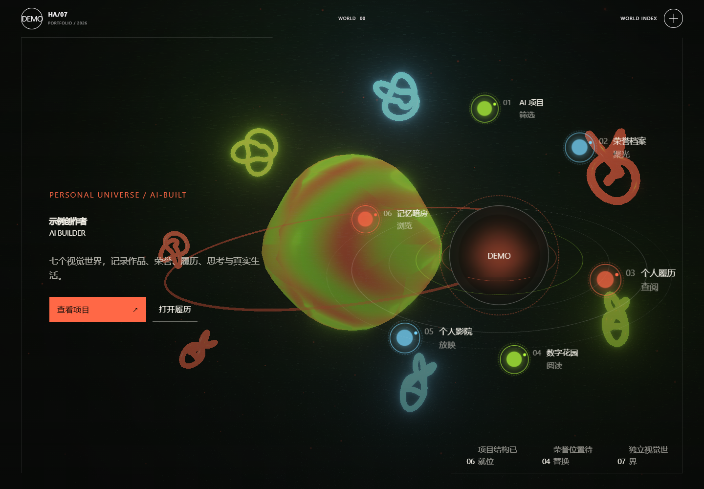

# HUMAN × AI / OPEN WORLDS

用七个可探索的视觉世界组织作品、履历与思考的静态个人站模板。

[在线模板演示](https://yangwei251003.github.io/human-ai-open-worlds/) · [作者 GitHub](https://github.com/yangwei251003) · [素材与许可](ASSET_LICENSES.md)

> 这是作品集模板。示例项目、荣誉、履历、文章、影片和照片均含占位内容，不能当作作者真实经历。当前是可运行的模板首版；真实资料接入与持续优化仍在开发中。演示默认禁止搜索引擎索引。



## 七个世界

| 页面 | 体验 |
| --- | --- |
| 门户 `/` | 七世界入口、空间视觉与精选项目 |
| 项目 `/projects/` | 分类筛选、样本台、详情与深链接 |
| 荣誉 `/honors/` | 展厅、楼层导航与详情弹窗；全部为示例档案 |
| 履历 `/resume/` | 能力标签、时间线与打印入口；使用演示身份 |
| 文字 `/journal/` | 文章书册与阅读器 |
| 影院 `/cinema/` | 海报、章节与文字稿；没有视频文件时展示说明 |
| 暗房 `/gallery/` | 胶片导航、翻面短记与灯箱；不包含私人照片 |

## 技术栈

Next.js 16 App Router 静态导出、React 19、TypeScript 6、React Three Fiber / Three.js、GSAP、Lenis、Motion、Zustand、Tailwind CSS 4。Geist 字体随源码保存，构建与运行无需请求字体服务。3D 与动态效果较多，弱设备建议在世界索引中启用减弱动态。

## 快速上手

需要 Node.js 24 与 npm；首次安装需要联网下载锁定依赖，不需要账号或 API 密钥。

```sh
npm ci
npm run dev
```

打开终端提示的本地地址。生产构建和预览：

```sh
npm run check
npm run start
```

默认导出在 `out/`，预览地址由 serve 提示。类型检查会先生成 Next 路由声明，新克隆也可直接执行。

## GitHub Pages 与子目录

仓库包含 `.github/workflows/pages.yml`。在仓库 Settings → Pages 中选择 GitHub Actions，推送 `main` 后构建发布 `out/`。工作流自动设置与仓库名一致的 `NEXT_PUBLIC_BASE_PATH`，图片、普通跨页锚点与社交封面支持子目录。

本地复现演示路径（PowerShell）：

```powershell
$env:NEXT_PUBLIC_BASE_PATH='/human-ai-open-worlds'
$env:NEXT_PUBLIC_SITE_URL='https://yangwei251003.github.io/human-ai-open-worlds/'
npm run build
node scripts/preview-prefix.mjs
```

打开 `http://127.0.0.1:4197/human-ai-open-worlds/`。换仓库名或部署到域名根目录后需重新构建。静态 RSC 兼容脚本仅添加副本，遇不同内容拒绝覆盖。

## 内容与目录

- `src/data/site.ts`：演示身份、描述、导航，不含私人联系方式或定位。
- `src/data/content.ts`：项目、荣誉、履历、文章及媒体示例。
- `src/app/`：七个页面与样式；`src/components/runtime/`：共享画布与导航状态。
- `public/media/`：AI 概念原图及优化版本，来源见 `IMAGE_CREDITS.md`。
- `src/app/fonts/`：Geist 字体子集及 OFL 许可。
- `docs/product-blueprint/`：原设计决策和历史项目记录。

真实资料经核实并替换所有示例后，才可显式设置 `NEXT_PUBLIC_SITE_READY=true` 并调整就绪判定以允许索引；仅配置 URL 不会开启索引。

## 验证

```sh
npm run licenses:generate
npm run check
npx playwright install chromium
npm run test:e2e
```

浏览器测试前需按上面的默认测试子路径构建。已有 Chrome 可设置环境变量 `BROWSER_CHANNEL=chrome`。测试覆盖桌面/手机七条路由、资源、noindex、横向布局、导航前缀、项目筛选及媒体弹窗。本次证据见 [验证记录](docs/release-validation.md)；历史 QA 分数不代表本次重测。

## 开源与后续计划

自有源码、文档与自行生成的概念图按 [MIT](LICENSE) 提供。第三方依赖和字体保留原许可；GSAP 使用自己的 Standard License，不能声称整个依赖树都按 MIT 或 OSI 许可开源。完整声明见 [素材与许可](ASSET_LICENSES.md)。

后续接入经核实的公开内容、补充媒体、继续验证低性能设备与无障碍体验。更新见 [CHANGELOG](CHANGELOG.md)。归档不含依赖缓存、构建目录、环境文件或私人材料，也不等同于原工作目录的全量个人资料备份。
